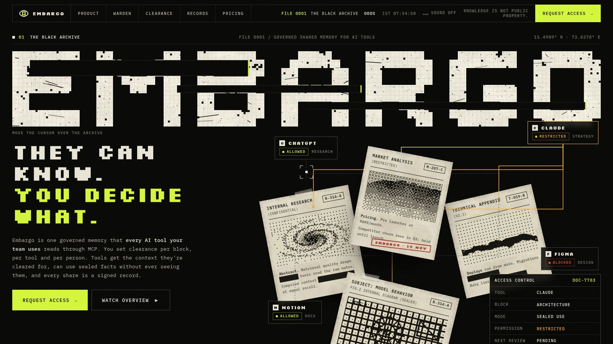

<div align="center">


<h3>They can know. You decide what.</h3>

<p>One governed memory for every AI tool your team uses.<br>
Every block of context has an owner, a rule and a record.</p>

<p>
<a href="https://embargoai.vercel.app"><b>Live site</b></a> ·
<a href="docs/embargo.md"><b>Product spec</b></a> ·
<a href="docs/features.md"><b>Feature list</b></a> ·
<a href="#quick-start"><b>Quick start</b></a> ·
<a href="#deploy"><b>Deploy</b></a>
</p>

<p>


</p>



</div>

<br>

## Why

Teams use Claude, ChatGPT, Cursor, Claude Code, Codex and their own agents side by side, and every one of them starts from zero.

- **Everyone re-explains the same project** to every tool, and pasting long documents wastes tokens.
- **Shared context goes stale and contradicts itself.** The pricing doc says ₹499, Friday's sales call says ₹599, and the AI picks one.
- **Nothing controls where context goes.** Team-only material ends up in public-facing agents, and a guest's words from a meeting get reused without their say.
- **There is no undo and no proof.** Nobody can take something back, or show later who shared what, with whom, under which rule.

## What Embargo does

| | |
|---|---|
| **Collect** | Paste, documents (`.md` `.txt` `.pdf` `.docx`), public URLs, GitHub repos, meetings from **Wispr Notetaker**, dictation with **Wispr Flow**, and blocks written by agents. |
| **Compress** | AI turns raw input into short structured blocks (title, summary, facts, decisions, open questions) and shows the tokens saved. |
| **Deliver** | One MCP connection per tool. The context compiler picks, trims and orders only what that tool and person are cleared for, inside a token budget. |
| **Maintain** | The AI Context Manager spots updates, contradictions, stale or duplicate blocks, gaps and missing rules, and puts suggestions in a context inbox for the founder's office to approve. New members get an onboarding starter pack. |
| **Control** | Per block: visibility (private, team, partner, public), allowed tools, expiry, timed embargo, purpose tags, and line-level rules for meeting statements. |
| **Protect** | Viewable, agent-only, **sealed use** (agents get answers, never the text) and sealed blocks encrypted on the client. An action check holds agent posts that would leak; an answer check stops sealed answers that quote the source. |
| **Consent** | Speakers in a meeting get a review link on WhatsApp, Slack or email and choose Allow, Team only or Block from AI for each flagged line. No account needed. |
| **Prove** | Shares, consent decisions, revokes and key destruction produce signed records, batched by Merkle root and attested on **Base** with EAS. The content is never in the record. |
| **Revoke** | Revoking a block destroys its encryption key, so every stored copy is unreadable, and tools stop receiving it on their next request. |

### Meet Warden

Embargo's agent is **Warden**, the keeper of the archive. Warden files and compresses what comes in, drafts changes in the context inbox, flags contradictions, holds agent actions that would leak, and answers sealed questions without quoting them.

## Quick start

You need **Node.js 22.13+**, npm, bash and curl. Everything else (database, keys, AI fallbacks, signed records) runs in-process.

```bash
git clone https://github.com/avirenusurya/Embargo.git
cd Embargo
./start.sh
```

`start.sh` installs dependencies, starts the server, seeds a demo workspace once and opens the browser. It prints the website and app URLs, the demo sign-ins and a ready-to-paste `claude mcp add` command.

| Option | |
|---|---|
| `./start.sh --no-open` | don't open a browser |
| `PORT=9000 ./start.sh` | use another port (or `--port 9000`) |
| `./start.sh --fresh` | delete local data first (asks first) |
| `DATA_DIR=/some/dir ./start.sh` | keep data somewhere else |

**Demo accounts** (choose *Developer sign-in* on the app's sign-in screen):

| Email | Role |
|---|---|
| `founder@demo.embargo` | owner |
| `priya@demo.embargo` | context admin (founder's office) |
| `rohan@demo.embargo` | editor |

<details>
<summary>Manual setup</summary>

```bash
npm install
npm start                                 # http://localhost:8787 · website at /, app at /app
API=http://localhost:8787 npm run seed    # demo workspace + an MCP token (idempotent)
```

Logs go to `data/server.log` and the demo MCP token to `data/demo-credentials.txt`. Dev secrets are generated once into `data/.dev-secrets.json`.

</details>

## Connect an AI tool

Create a connection under **Connections** in the app; it shows the exact setup for each tool.

```bash
claude mcp add --transport http embargo https://embargoai.vercel.app/mcp --header "Authorization: Bearer emb_..."
```

Local stdio package, which also keeps **sealed blocks** encrypted on your machine:

```bash
node bin/embargo-mcp.mjs --token emb_... --api http://localhost:8787
node bin/embargo-mcp.mjs --token emb_... sealed-init                 # prints a recovery key once
node bin/embargo-mcp.mjs --token emb_... sealed-add "Board notes" notes.md
```

| MCP tool | What it does |
|---|---|
| `get_context` | Compiled, permitted context for a task, inside a token budget, with a withheld count |
| `list_blocks` · `read_block` | Browse and read blocks the tool may see |
| `create_block` | Write a new block (private by default) |
| `report_context_use` | Tell Embargo which items helped, to improve future compiles |
| `request_access` | Ask a block's owner for access |
| `ask_sealed` | Get an answer from a sealed block without receiving its text |
| `perform_action` | Post to Slack, Notion and more through viaSocket, after the action check |

## Configuration

With no configuration, Embargo runs on embedded Postgres (PGlite + pgvector), the local key provider, heuristic AI, and records signed off-chain. Each integration turns on with environment variables; every setting is listed in [`.env.example`](.env.example).

| Turn on | Set |
|---|---|
| Model-quality compression, classification and sealed answers | `LLM_API_KEY` (OpenAI or any compatible endpoint via `LLM_BASE_URL`) |
| Managed Postgres | `DATABASE_URL` (Postgres 16 with pgvector, for example Neon or Supabase) |
| On-chain records | `RPC_URL`, `CHAIN_ID`, funded `RELAYER_PRIVATE_KEY`, then `npm run chain:register-schema` and `EAS_SCHEMA_UID` |
| Wispr Notetaker import | `WISPR_MCP_URL` |
| Notifications and agent actions | viaSocket flow URLs, saved per workspace under Integrations |
| Rights graph | `TIGERGRAPH_HOST`, `TIGERGRAPH_TOKEN`, and `infra/tigergraph/schema.gsql` |
| Billing | `DODO_API_KEY`, `DODO_WEBHOOK_SECRET`, `DODO_PRODUCT_TEAM` |
| Object storage, AWS KMS, email | see `.env.example` |

## Deploy

The service is a single Node process: API, remote MCP endpoint (`/mcp`), background workers, website (`/`) and app (`/app`).

```
browser ─▶ Vercel (embargoai.vercel.app) ── static website
                     │
                     └─ /app, /auth, /mcp, API ──▶ Render (Docker) ──▶ Postgres + pgvector
```

### 1 · Render (backend)

1. Create a free Postgres with pgvector, for example on [Neon](https://neon.tech), and copy its direct (not pooled) connection string. Put the Render service in the same region as the database; `render.yaml` uses Ohio, which matches Neon's `us-east-2`.
2. Render dashboard → **New → Blueprint** → select this repository. Render reads [`render.yaml`](render.yaml).
3. When asked, paste the connection string into `DATABASE_URL` and a `0x`-prefixed 32-byte hex key into `RELAYER_PRIVATE_KEY` (for example `node -e "console.log('0x'+require('crypto').randomBytes(32).toString('hex'))"`). `API_URL` is already your public URL (`https://embargoai.vercel.app`). Add `LLM_API_KEY` if you have one.
4. Deploy. On first boot [`scripts/demo-start.sh`](scripts/demo-start.sh) starts the server, waits for `/ready` and seeds the demo workspace. `https://<service>.onrender.com/health` should return `{"ok":true}`.

`DATABASE_URL` matters on the free plan: the embedded database needs more than its 512 MB of memory, and its disk is wiped on every deploy. Keep `SESSION_SECRET`, `LOCAL_MASTER_KEY` and `RECORD_HMAC_GLOBAL_KEY` once set: the data in the database is encrypted with them.

### 2 · Vercel (website and public domain)

1. If your Render URL is not `https://embargoai.onrender.com`, change the rewrite destination in [`vercel.json`](vercel.json).
2. Vercel → **Add New → Project** → import this repository → framework preset **Other** → deploy. Install, build and output settings come from `vercel.json`.

Vercel serves the website as static files and proxies everything else to Render, so the site stays fast while Render wakes up.

### 3 · Keep Render awake (cron-job.org)

Render's free plan sleeps after 15 minutes without traffic. On [cron-job.org](https://cron-job.org), create a cron job: URL `https://<service>.onrender.com/health`, every **10 minutes**, method GET.

### Demo mode and production

`render.yaml` sets `NODE_ENV=demo`, which keeps developer sign-in on for the demo accounts. Anyone can sign in with any email in that mode, so use it for demos only. For real data set `NODE_ENV=production`: developer sign-in turns off and every secret in `.env.example` becomes required.

<details>
<summary>Docker</summary>

```bash
docker build -t embargo .
docker run -p 8787:8787 -e NODE_ENV=demo -e API_URL=http://localhost:8787 embargo bash scripts/demo-start.sh
```

</details>

## Tests and evaluation

```bash
npm test                                          # unit, security and integration suites
API=http://localhost:8787 npm run smoke           # end-to-end checks over REST and real MCP clients
npm run eval                                      # evaluation harness → src/eval/out/REPORT.md
API=http://localhost:8787 npm run test:local-mcp  # stdio package, sealed blocks, recovery
npm run test:chain                                # EAS contracts on a local Anvil chain
npm run typecheck
```

From the latest [evaluation report](src/eval/out/REPORT.md):

| | |
|---|---|
| **0** withheld items served | across 300,000 policy cases and 352 compiles |
| **0** sealed leaks | 48 sealed answers checked for verbatim and over-disclosure |
| **90.9%** fewer tokens | median, versus pasting the whole permitted library |
| **23 ms** | median `get_context` (auth + compile + format) |
| **97.6%** action-check accuracy | with 0% false positives on clean payloads |

## Project structure

```
src/
  api/          Fastify server, routes, remote MCP endpoint (/mcp)
  mcp/          tool schemas, gateway (auth, scopes, rate limits), stdio package
  core/         policy engine, context compiler, context manager, consent, sealed use, action check, revoke
  ingest/       pipeline, extractors (pdf, docx, html), GitHub, Wispr, Whisper
  ai/           LLM client, prompt loader, schemas, heuristic fallbacks, sensitivity rules
  crypto/       envelope encryption (local or KMS), client-side sealed-block crypto
  chain/        EAS attestations, Merkle batching, relayer, verification
  integrations/ viaSocket, TigerGraph, Dodo Payments
  jobs/         Postgres outbox queue and schedules
  web/          website, app, review, verify and card pages (no build step)
  eval/         evaluation harness and labelled fixtures
prompts/        versioned LLM prompts
test/           unit, security and integration suites
scripts/        seed, smoke, MCP and chain tests, record verifier, hosted start, Vercel build
docs/           product spec and feature list
```

## Built with

[Wispr Flow](https://wisprflow.ai) (Notetaker import and dictation) · [viaSocket](https://viasocket.com) (review links, notifications, agent actions) · [TigerGraph](https://www.tigergraph.com) (rights graph) · [Dodo Payments](https://dodopayments.com) (billing) · [AI Grants India](https://aigrants.in) (model credits) · [Base](https://base.org) and [EAS](https://attest.org) (signed records) · Fastify · PGlite · pgvector · MCP SDK · GSAP · Lenis

<br>

<div align="center">
<sub>Built for Hacker House Goa 2026 · Knowledge is not public property.</sub>
</div>
